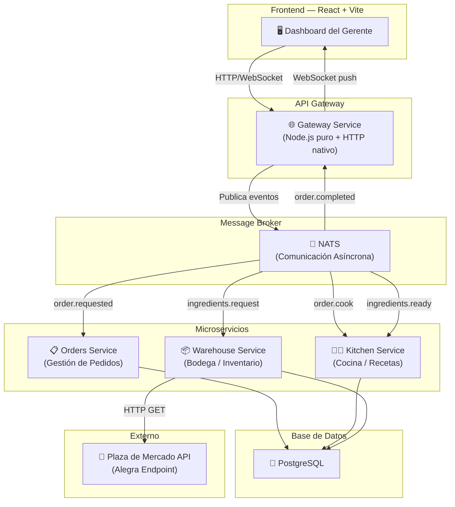
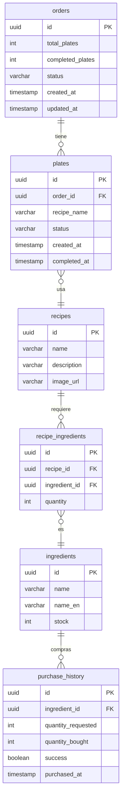
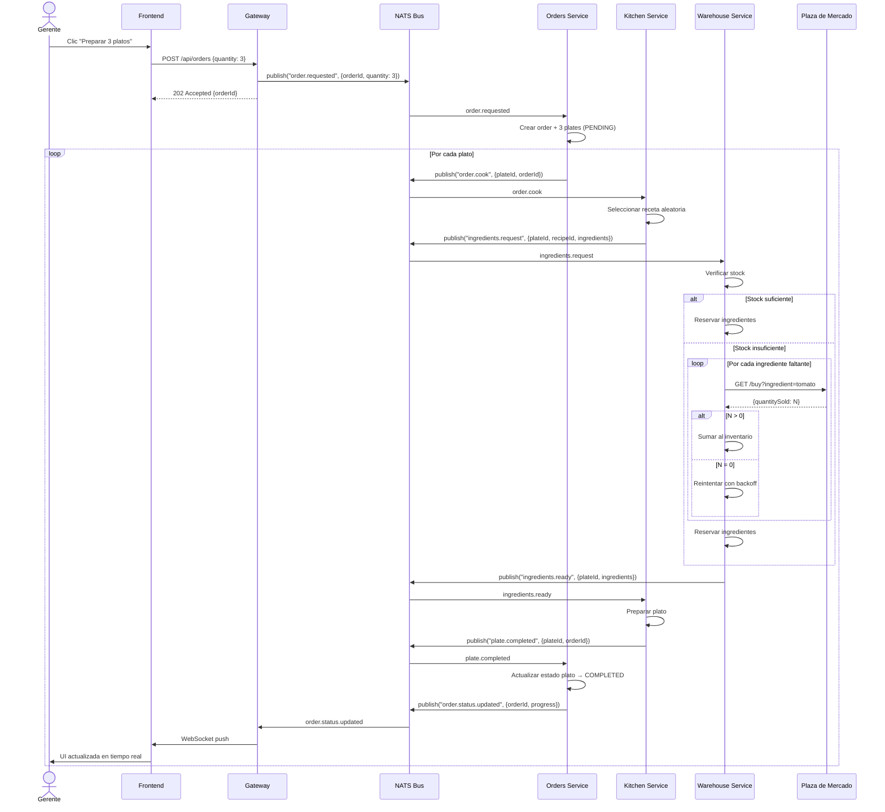
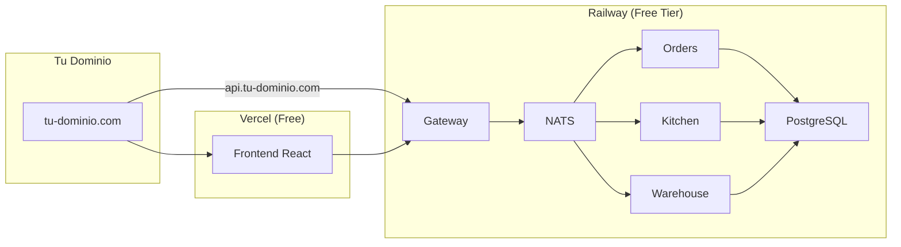

# 🍽️ Plan de Arquitectura — Sistema de Donación de Comida "Alegra Restaurant"

## 1. Visión General

Un sistema de microservicios serverless que automatiza la solicitud, preparación y entrega de platos de comida en una jornada de donación masiva. El gerente interactúa con una interfaz visual intuitiva y en tiempo real.

---

## 2. Arquitectura de Microservicios



---

## 3. Microservicios — Responsabilidades

### 3.1 🌐 API Gateway (`gateway-service`)
| Aspecto | Detalle |
|---------|---------|
| **Puerto** | 3000 |
| **Responsabilidad** | Punto de entrada único. Recibe peticiones HTTP del frontend, publica eventos en NATS y mantiene conexiones WebSocket para push en tiempo real |
| **Tecnología** | `node:http` nativo + `ws` (WebSocket) + cliente NATS |
| **Endpoints** | `POST /api/orders` — Crear pedido de N platos |
| | `GET /api/orders` — Listar todos los pedidos y su estado |
| | `GET /api/orders/:id` — Detalle de un pedido |
| | `GET /api/warehouse/inventory` — Estado actual del inventario |
| | `GET /api/kitchen/recipes` — Listar las 6 recetas |
| | `GET /api/stats` — Estadísticas generales |
| | `WS /ws` — Canal WebSocket para eventos en tiempo real |

### 3.2 📋 Orders Service (`orders-service`)
| Aspecto | Detalle |
|---------|---------|
| **Responsabilidad** | Gestiona el ciclo de vida de cada pedido (order). Crea los registros, rastrea el estado de cada plato individual |
| **Escucha** | `order.requested` — Cuando el gerente solicita N platos |
| **Publica** | `order.cook` — Un evento por cada plato individual para que la cocina lo procese |
| | `order.status.updated` — Notifica cambios de estado |
| **Estados de un plato** | `PENDING` → `IN_PROGRESS` → `WAITING_INGREDIENTS` → `PREPARING` → `COMPLETED` |

### 3.3 👨‍🍳 Kitchen Service (`kitchen-service`)
| Aspecto | Detalle |
|---------|---------|
| **Responsabilidad** | Selecciona recetas aleatorias, solicita ingredientes a la bodega, y "prepara" el plato cuando tiene todo |
| **Escucha** | `order.cook` — Recibe solicitud para preparar un plato |
| | `ingredients.ready` — La bodega confirma que los ingredientes están disponibles |
| **Publica** | `ingredients.request` — Solicita ingredientes a la bodega |
| | `plate.completed` — Plato listo para entregar |

### 3.4 📦 Warehouse Service (`warehouse-service`)
| Aspecto | Detalle |
|---------|---------|
| **Responsabilidad** | Gestiona inventario de ingredientes. Inicia con 5 unidades de cada uno. Si no tiene suficiente, compra en la plaza de mercado |
| **Escucha** | `ingredients.request` — La cocina necesita ingredientes |
| **Publica** | `ingredients.ready` — Ingredientes reservados/disponibles |
| | `ingredients.purchased` — Se compraron ingredientes en el mercado |
| **API externa** | `GET https://recruitment.alegra.com/api/farmers-market/buy?ingredient={name}` |

---

## 4. Modelo de Datos (PostgreSQL)



### Datos Iniciales

**Ingredientes** (10 en total, stock inicial = 5 cada uno):

| Español | Inglés (para API) | Stock Inicial |
|---------|-------------------|---------------|
| Tomate | tomato | 5 |
| Limón | lemon | 5 |
| Patatas | potato | 5 |
| Arroz | rice | 5 |
| Ketchup | ketchup | 5 |
| Lechuga | lettuce | 5 |
| Cebolla | onion | 5 |
| Queso | cheese | 5 |
| Carne | meat | 5 |
| Pollo | chicken | 5 |

**6 Recetas** (cada una con al menos 1 ingrediente de la lista):

| # | Receta | Ingredientes |
|---|--------|-------------|
| 1 | 🍔 Hamburguesa Clásica | Carne (1), Lechuga (1), Tomate (1), Queso (1), Cebolla (1), Ketchup (1) |
| 2 | 🍗 Pollo a la Plancha | Pollo (1), Arroz (2), Limón (1) |
| 3 | 🥗 Ensalada Fresca | Lechuga (2), Tomate (1), Cebolla (1), Limón (1) |
| 4 | 🍟 Patatas con Queso | Patatas (2), Queso (1), Ketchup (1) |
| 5 | 🌮 Tacos de Carne | Carne (1), Tomate (1), Cebolla (1), Lechuga (1), Queso (1) |
| 6 | 🍚 Arroz con Pollo | Arroz (2), Pollo (1), Tomate (1), Cebolla (1) |

---

## 5. Flujo de Eventos (Comunicación Asíncrona)



---

## 6. Estructura de Carpetas del Proyecto

```
alegra-restaurant/
├── docker-compose.yml
├── .env
├── PLANNING.md
├── README.md
│
├── services/
│   ├── gateway/
│   │   ├── Dockerfile
│   │   ├── package.json
│   │   ├── tsconfig.json
│   │   └── src/
│   │       ├── index.ts
│   │       ├── router.ts
│   │       ├── websocket.ts
│   │       ├── nats-client.ts
│   │       └── types.ts
│   │
│   ├── orders/
│   │   ├── Dockerfile
│   │   ├── package.json
│   │   ├── tsconfig.json
│   │   └── src/
│   │       ├── index.ts
│   │       ├── handlers/
│   │       ├── database.ts
│   │       ├── repositories/
│   │       └── types.ts
│   │
│   ├── kitchen/
│   │   ├── Dockerfile
│   │   ├── package.json
│   │   ├── tsconfig.json
│   │   └── src/
│   │       ├── index.ts
│   │       ├── handlers/
│   │       ├── recipes.ts
│   │       ├── database.ts
│   │       └── types.ts
│   │
│   └── warehouse/
│       ├── Dockerfile
│       ├── package.json
│       ├── tsconfig.json
│       └── src/
│           ├── index.ts
│           ├── handlers/
│           ├── market-client.ts
│           ├── inventory.ts
│           ├── database.ts
│           └── types.ts
│
├── database/
│   └── init.sql
│
└── frontend/
    ├── Dockerfile
    ├── package.json
    ├── vite.config.ts
    ├── tsconfig.json
    └── src/
        ├── main.tsx
        ├── App.tsx
        ├── components/
        ├── hooks/
        ├── services/
        └── styles/
```

---

## 7. Stack Tecnológico

| Capa | Tecnología | Justificación |
|------|-----------|---------------|
| **Frontend** | React 18 + Vite + TypeScript | Ecosistema maduro, excelente para UIs reactivas en tiempo real |
| **Backend** | Node.js 20 + TypeScript + `node:http` nativo | Sin Express/Nest, cumple requerimiento |
| **Message Broker** | NATS | Ultraligero (~15MB), pub/sub nativo, latencia sub-ms |
| **Base de Datos** | PostgreSQL 16 | Requerimiento del proyecto |
| **Driver DB** | `pg` (node-postgres) | Driver nativo, SQL directo |
| **WebSocket** | `ws` | Librería mínima para WS en Node.js |
| **Contenedores** | Docker + Docker Compose | Un contenedor por servicio |

---

## 8. Manejo de Errores y Resiliencia

| Escenario | Estrategia |
|-----------|-----------|
| Plaza de mercado retorna `quantitySold: 0` | Retry con backoff exponencial (máx 5 intentos) |
| NATS no disponible | Reconexión automática del cliente |
| PostgreSQL no disponible | Health check + reintentos |
| Ingrediente agotado tras reintentos | Marcar plato como `FAILED`, notificar gerente |
| Pedido masivo (100+ platos) | Procesamiento concurrente con rate limiting |

---

## 9. Propuestas de Despliegue Gratuito (con dominio propio)

### Opción A — ⭐ RECOMENDADA: Railway.app (Free Tier)



| Aspecto | Detalle |
|---------|---------|
| **Frontend** | Vercel (gratis ilimitado para proyectos personales) |
| **Backend (4 servicios + NATS)** | Railway free tier ($5 USD de crédito mensual) |
| **PostgreSQL** | Railway incluye PostgreSQL gratis |
| **Dominio** | CNAME de `tu-dominio.com` → Vercel + `api.tu-dominio.com` → Railway |
| **Pros** | Deploy directo desde GitHub, soporte Docker nativo, SSL automático |
| **Contras** | El free tier tiene límite de $5/mes, puede quedarse corto si hay mucho tráfico |

---

### Opción B — Render.com (Free Tier)

| Aspecto | Detalle |
|---------|---------|
| **Frontend** | Render Static Site (gratis) |
| **Backend** | Render Web Services (free tier: 750h/mes compartidas entre servicios) |
| **PostgreSQL** | Render PostgreSQL free (90 días, luego $7/mes) |
| **NATS** | Desplegado como Private Service en Render |
| **Dominio** | Custom domain con SSL automático incluido |
| **Pros** | Muy fácil de configurar, deploy desde GitHub, buen free tier |
| **Contras** | Los servicios free se "duermen" tras 15 min de inactividad (cold start ~30s). La BD free expira a los 90 días |

---

### Opción C — Fly.io + Supabase

| Aspecto | Detalle |
|---------|---------|
| **Frontend** | Vercel o Netlify (gratis) |
| **Backend (4 servicios)** | Fly.io free tier (3 VMs compartidas de 256MB) |
| **NATS** | Desplegado como una VM en Fly.io |
| **PostgreSQL** | Supabase free tier (500MB, 2 proyectos) |
| **Dominio** | CNAME → Fly.io con certificado SSL automático |
| **Pros** | Fly.io corre Docker nativo, baja latencia global, Supabase incluye dashboard de BD |
| **Contras** | Solo 3 VMs gratis (tendríamos que combinar servicios o ser creativos). Requiere CLI de Fly |

---

### Opción D — Oracle Cloud Free Tier (Always Free)

| Aspecto | Detalle |
|---------|---------|
| **Todo el stack** | 1 VM ARM con 4 cores + 24GB RAM (gratis para siempre) |
| **Setup** | Docker Compose directamente en la VM |
| **PostgreSQL** | En la misma VM o Oracle Autonomous DB free |
| **Dominio** | Apuntar A record de tu dominio a la IP pública de la VM |
| **Pros** | Recursos generosos, gratis para siempre, control total |
| **Contras** | Requiere configurar la VM manualmente (nginx, firewall, SSL con Let's Encrypt). No es "managed" |

---

### Comparativa Rápida

| Criterio | Railway + Vercel | Render | Fly.io + Supabase | Oracle Cloud |
|----------|:---:|:---:|:---:|:---:|
| **Facilidad de setup** | ⭐⭐⭐⭐⭐ | ⭐⭐⭐⭐ | ⭐⭐⭐ | ⭐⭐ |
| **Gratis real** | ⭐⭐⭐ | ⭐⭐⭐ | ⭐⭐⭐⭐ | ⭐⭐⭐⭐⭐ |
| **Soporte Docker** | ✅ | ✅ | ✅ | ✅ |
| **Custom Domain + SSL** | ✅ | ✅ | ✅ | ✅ (manual) |
| **WebSocket support** | ✅ | ✅ | ✅ | ✅ |
| **Cold starts** | No | Sí (15min) | No | No |
| **Ideal para** | MVP rápido | Demo/prueba | Producción ligera | Control total |

> **Mi recomendación**: **Opción A (Railway + Vercel)** para entregar rápido con calidad profesional, o **Opción D (Oracle Cloud)** si quieres algo gratis permanente y no te importa configurar la VM.

---

## 10. Configuración de Dominio Propio

Independiente de la opción elegida, la configuración DNS será:

```
tu-dominio.com          → CNAME → frontend (Vercel/Render/Netlify)
api.tu-dominio.com      → CNAME → backend gateway (Railway/Render/Fly)
```

O en el caso de Oracle Cloud:
```
tu-dominio.com          → A record → IP_DE_TU_VM
api.tu-dominio.com      → A record → IP_DE_TU_VM (Nginx reverse proxy)
```

SSL/TLS se obtiene automáticamente en todos los servicios managed, o con **Let's Encrypt + Certbot** en Oracle Cloud.

---

## 11. Plan de Ejecución (Fases)

### Fase 1 — Infraestructura Base
- [ ] Configurar `docker-compose.yml` con PostgreSQL + NATS
- [ ] Crear schema de base de datos (`init.sql`) con datos seed
- [ ] Estructura base de cada microservicio (package.json, tsconfig, Dockerfile)
- [ ] Módulo compartido de conexión a NATS y PostgreSQL

### Fase 2 — Microservicios Core
- [ ] **Warehouse Service**: Inventario + compras en plaza de mercado
- [ ] **Kitchen Service**: Selección aleatoria de recetas + solicitud de ingredientes
- [ ] **Orders Service**: Gestión del ciclo de vida de pedidos
- [ ] **Gateway Service**: HTTP router nativo + WebSocket + bridge NATS→WS

### Fase 3 — Frontend
- [ ] Setup React + Vite + TypeScript
- [ ] Dashboard principal con diseño premium
- [ ] Conexión WebSocket para tiempo real
- [ ] Componentes: OrderPanel, KitchenView, WarehouseView, OrderHistory, Stats

### Fase 4 — Integración y Pulido
- [ ] Test end-to-end del flujo completo
- [ ] Animaciones y micro-interacciones en el frontend
- [ ] Manejo de errores robusto
- [ ] Documentación final (README)
- [ ] Deploy a producción

---

## 12. Verificación de Requerimientos

| Requerimiento | ✅ | Cómo |
|---------------|:-:|------|
| TypeScript + JavaScript | ✅ | Todo el proyecto en TypeScript |
| Node.js puro (sin Express/Nest) | ✅ | `node:http` nativo en el Gateway |
| Serverless / Microservicios | ✅ | 4 servicios independientes con Docker |
| Cada servicio con su Dockerfile | ✅ | Un Dockerfile por servicio |
| Comunicación asíncrona | ✅ | NATS pub/sub |
| Frontend moderno | ✅ | React 18 + Vite |
| PostgreSQL | ✅ | Servicio dedicado en Docker |
| 6 recetas con ingredientes de la lista | ✅ | Seed data en `init.sql` |
| Bodega inicia con 5 de cada ingrediente | ✅ | Seed data en `init.sql` |
| Compra en plaza de mercado si falta stock | ✅ | Warehouse Service → HTTP GET |
| Receta aleatoria | ✅ | Kitchen Service selecciona al azar |
| Descuento de inventario al preparar | ✅ | Warehouse reserva y descuenta |
| Interfaz en tiempo real | ✅ | WebSocket Gateway → Frontend |
| Interfaz intuitiva para no-técnicos | ✅ | Dashboard visual con animaciones |
| Dominio propio | ✅ | DNS CNAME/A record según opción |
